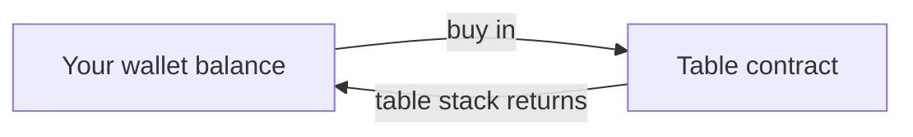

# How Stacked works

Stacked Poker is two systems, each doing what it's good at: Stacked's servers run the live game, and each real-money table's own contract holds the money.

A contract (a smart contract) is a program that runs on a blockchain and holds funds under fixed rules. Base is an Ethereum-based network with very low fees. USDC is a digital dollar that holds a stable value.

## Why two systems

Poker that ran entirely onchain would be slow. Every action (fold, call, raise) would have to wait for the blockchain to confirm, and gas, the small network fee to record something onchain, would make low-stakes play unaffordable. Poker run entirely by an operator is fast, but it asks you to trust the operator with your money.

Stacked combines them. The parts that need speed run on Stacked's servers. The parts that need trust live onchain.

The live game (card shuffling, betting rounds, turn order, the action timer, chat and Host approvals) runs on Stacked's servers in real time. The money lives onchain: one contract per real-money table, deployed on Base when the Host creates it. That contract holds your USDC, settles every cash-table hand, and gives you the 24-hour exit.

Your own money flows in a simple loop:

## How the two parts fit together

While you're playing, Stacked's servers track the state of the table: who has which cards, whose turn it is, what the pot is. None of this is onchain. Your actions during a hand aren't confirmed by your wallet, and nothing is recorded to Base while the hand is in progress.

When a cash-table hand finishes, it settles on the table's contract: the chip movements are recorded onchain and everyone's seat balances update. Settlement is fast, typically under 5 seconds on Base, and runs in the background, so it never interrupts play. You pay no gas for it: Stacked covers that cost. **Stacked's servers decide each hand; the contract holds the money and records every result.** What you can take out is what the contract holds in your seat balance, and the contract only ever pays that out to you.

Tournaments work differently. A tournament's hands don't settle one by one: its own contract pays out when the tournament ends.

## What this means for trust

Stacked's servers can:

- Run the game incorrectly, in theory.
- Record a hand's result wrong, in theory. The contract limits where money can go (to players, the Host's earnings or the platform fee), but it doesn't replay the hand.

Stacked's servers can't:

- Move your money. Funds sit in the contract, and its money paths pay out only to players, the Host's earnings or the platform fee.
- Send your money anywhere but to you. In an emergency, Stacked can pause the normal return of table stacks. That delays it, but can't move your money anywhere else.

This is the trade-off: you trust Stacked to run the game fairly, but not to hold your money. The onchain part is what lets you check the money side yourself.

## What you can check onchain

- The table's contract for any real-money table you play at. Read the code on Basescan.
- Every cash-table settlement. Each hand's outcome is a transaction you can pull up.
- The transactions that move your money into and out of a table, visible from your wallet's transaction history.

## What's next

- [How custody works →](/docs/your-money/custody): the contract side of the system in detail.
- [How hands settle →](/docs/your-money/settlement): what happens onchain after each hand.
- [Security and contracts →](/docs/about/security): audit status, the shuffle, source code.
