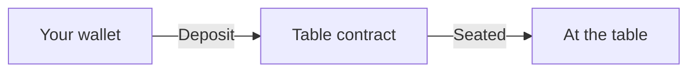

# Deposits

A deposit is how you move USDC — a digital dollar that holds a stable value — from your wallet into a real-money table so you can sit down.

## What you need

- A connected wallet — any popular wallet (Coinbase Wallet, MetaMask, Rainbow, WalletConnect, and others), or the embedded wallet Stacked creates for you if you don't have one.
- USDC on Base in that wallet. Base is an Ethereum-based network with very low fees. Signed in? Click **Add funds** in the header to buy USDC with a card or send it from an exchange. See [Get USDC on Base](/docs/getting-started/get-usdc-on-base).
- Network fees depend on how you signed in. A network fee (also called gas) is the small charge for recording a transaction on Base. If you signed in with Google, X, Discord, email or another sign-in option (not your own wallet), Stacked covers it. If you connected your own wallet, you pay it, so keep a small amount of ETH on Base in that wallet. It is typically under a cent.

## How depositing works

When you click sit at a real-money table, your USDC moves from your wallet into that table's contract — the on-chain account that holds the money for that table:

1. **Pick your buy-in.** You choose how much USDC you want to put on the table, within whatever the contract allows for that table. Each real-money table is its own smart contract — a small program on Base that holds the money under fixed rules — deployed when the Host creates the table.
2. **Sign the transaction.** Your wallet pops up to confirm the deposit. The first time you deposit at a specific table, your wallet may ask you to authorize USDC spending first — a one-time approval that's standard for any app that handles USDC. After that, subsequent deposits to the same table need only the deposit signature.
3. **Wait for confirmation.** The deposit confirms on Base in a few seconds.
4. **Sit down.** Tables seat you instantly by default. Your chips show up at the table and the next hand deals you in.

If you connected your own wallet, you pay the network fee on the deposit because it's a transaction you sign. If you signed in with Google, X, Discord or email, Stacked covers it. Either way, the fee to settle each hand once you're seated is on Stacked.

## If the Host approves players by hand

A Host can turn off Auto-Accept in their table's Settings tab. At that table, your deposit puts you in the Host's pending list with your wallet and buy-in, and the Host approves or declines.

If the Host declines your seat or doesn't get to it, you don't lose your USDC. The contract grants you withdrawal permission and you can click withdraw to pull your deposit back to your wallet. Same flow as any normal withdrawal — see [Withdrawals](/docs/your-money/withdrawals).

Stacked never moves your funds without your signature. If your seat doesn't happen, your money waits in the contract until you click to retrieve it.

## What's next

- [Withdrawals →](/docs/your-money/withdrawals) — moving USDC back out of a table.
- [Joining a table →](/docs/playing/joining-a-table) — the full lobby and seating flow.
- [How custody works →](/docs/your-money/custody) — what the table contract holds and how.
