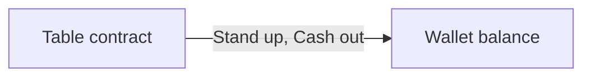

# Cash out

Cash out is the button that returns your table stack to your wallet balance after you stand up. Money in your wallet balance can then go to an exchange or another wallet.

## Cash out from a table

There are three steps: stand up between hands, tap **Cash out**, and confirm. The table's contract then sends your stack to your wallet balance.

1. **Stand up.** Leave your seat between hands. You can't leave mid-hand: you finish the current hand first. Once you're no longer seated, Cash out is available.
2. **Tap Cash out.** The contract sends your stack straight to your wallet balance, with no queue, no Stacked approval and no schedule. The amount is exactly your table stack at the moment you left.
3. **Confirm.** If you signed in with your own wallet, it asks you to sign.

If you signed in with your own wallet, you pay the small network fee (gas) on this step, because it's a transaction you sign. On Base, the low-fee network Stacked runs on, it is typically under a cent. If you signed in with a social account, email or phone, Stacked covers it.

## From your wallet balance to an exchange or wallet

Your wallet balance is money away from any table. Cash out also sends it to an exchange or a wallet you choose. Check the destination before you confirm: a cash out can't be reversed.

## Other ways your stack comes back

The same step applies any time a contract is holding your money for you:

- **You stand up.** The standard case above.
- **The Host removes you between hands.** You get permission to take your stack back, then you tap Cash out.
- **The Host ends the table.** Every seated player gets permission to take their stack back.
- **The Host declined your seat after you bought in.** This can only happen at a table where the Host approves players by hand. Your buy-in waits in the contract until you take it back. See [Buying in](/docs/your-money/deposits).
- **The 24-hour exit unlocks.** A separate path for the rare case where hands stop settling. See [The 24-hour exit](/docs/your-money/emergency-exit).

In every case, **Stacked can't send your money anywhere but to you.**

## Why only between hands

Your table stack is whatever was last settled onchain, and that updates at the end of each hand. Waiting until the current hand finishes makes sure the contract knows the correct amount to return. It isn't a Stacked policy decision. It's how the contract sees things.

## What's next

- [Buying in →](/docs/your-money/deposits): moving money from your wallet balance to a table.
- [How custody works →](/docs/your-money/custody): what the contract holds and how.
- [The 24-hour exit →](/docs/your-money/emergency-exit): the safety net if hands stop settling.
